<h3><code>adrian@github ~ $ ./contributions.sh</code></h3>

  

<h3><code>adrian@github ~ $ whoami</code></h3>
<table>
  <tr>
    <td valign="top"></td>
    <td valign="top"></td>
  </tr>
</table>

 

<h3><code>adrian@github ~ $ ls ~/stack</code></h3>

  

<h3><code>adrian@github ~ $ cat proyecto-estrella.md</code></h3>

| Proyecto | Stack | Lo más potente |
|---|---|---|
| [**AgroConecta**](https://github.com/Ezquerrito88/AgroConecta) | Angular, Laravel, Docker, MySQL, Azure | Marketplace agrícola, pagos, panel admin, chat en tiempo real, despliegue cloud |

 

<h3><code>adrian@github ~ $ ./contacto.sh</code></h3>

